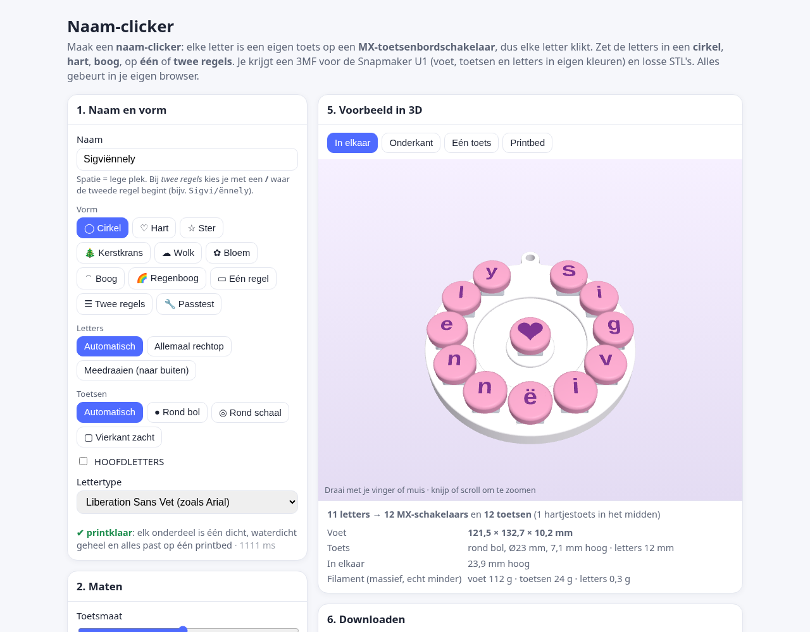

# 20 · Naam-clicker (elke letter klikt)

Maak een **naam-clicker**: elke letter is een eigen toets op een **MX-toetsenbordschakelaar**, dus je kunt op elke letter klikken. Je zet de letters in een **cirkel**, **hart**, **ster**, **kerstkrans**, **wolk**, **bloem**, **boog** of **regenboog**, op **één regel** of op **twee regels**. Je krijgt een **3MF voor de Snapmaker U1** met de voet, de toetsen en de letters in hun eigen kleur, en losse **STL's**.

Alles draait in je eigen browser. Er wordt niets geüpload en er zijn geen accounts of kosten.

## Gebruiken

1. Open de live link: https://tech-demos-henna.vercel.app/20-naam-clicker/
2. Typ de **naam**. Een **ë**, **é** of **ü** werkt gewoon. Een spatie geeft een lege plek.
3. Kies een **vorm**. Bij alle vormen staan de letters rechtop en lees je ze met de klok mee.
   - **Cirkel**: een ring met een verdiepte middenplaat en een hartjestoets in het midden.
   - **Hart**: hetzelfde, in een vloeiend hart.
   - **Ster**: de letters staan op de punten en in de binnenhoeken van de ster, met een hartje in het midden.
   - **Kerstkrans**: een ring met hulstblaadjes en rode besjes. De kleuren springen vanzelf naar kerstkleuren (rode toetsen en groene hulst).
   - **Wolk** en **Bloem**: een dichte wolk of een bloem met blaadjes, met een hartje in het midden.
   - **Boog**: de letters staan in een boog.
   - **Regenboog**: een boog met een rechte onderkant. Met **losse standaard** krijg je een voetje met een sleuf, zodat hij een beetje schuin rechtop staat.
   - **Eén regel** of **Twee regels**: bij twee regels zet je een **/** waar de tweede regel begint, bijvoorbeeld `Sigvi/ënnely`.
   - **Passtest**: één vakje met één toets. Print die eerst.
4. Kies de **toetsvorm**: **rond bol** (een bolle bovenkant), **rond schaal** (een holle bovenkant, zoals een echte toetsenbordtoets) of **vierkant zacht** (vierkant met ronde hoeken). Bij *Automatisch* krijgen de boog, de regenboog en de regels vierkante toetsen en de rest ronde toetsen.
5. Schuif aan de **maten** in millimeters: toetsmaat, letterhoogte, ruimte tussen de toetsen, bodemdikte, rand en de afronding van de bovenrand.
6. Onder **Extra's** zet je het oogje, de middenplaat, de hartjestoets, de standaard en de uitdrukgaatjes aan of uit, en kies je de kleuren. De uitdrukgaatjes staan nu standaard **uit**, zodat de onderkant helemaal dicht en glad is.
7. Bekijk het model met **In elkaar**, **Onderkant**, **Eén toets** of **Printbed**.
8. Kijk of er **✔ printklaar** staat en download de **3MF (U1)** of de losse STL's.

## Wat heb je nodig

- **Eén MX-schakelaar per letter**, plus één voor de hartjestoets. Voor *Sigviënnely* zijn dat **12 schakelaars** bij cirkel, hart, ster, wolk en bloem (11 letters en 1 hartje). Bij de kerstkrans, de boog, de regenboog en de regels zijn het er **11**.
- MX-stijl betekent: Cherry MX, Gateron, Outemu, Kailh Box of Akko, met 3 of 5 pinnetjes. **Blauwe** schakelaars klikken het hardst, **bruine** voelen een tikje en **rode** zijn stil. Een zakje van 30 tot 100 stuks kost ongeveer 10 tot 20 euro.
- Een sleutelring van 25 mm, als je het oogje wilt gebruiken.

## Printen op de Snapmaker U1

1. Open de 3MF in **Snapmaker Orca**. Alles ligt al goed op het printbed.
2. De kleuren staan per kop klaar. **Kop 1** is de voet (en de standaard), **kop 2** de toetsen (en de besjes van de krans), **kop 3** de letters en **kop 4** de tweede toetskleur of de hulst. Zet in Orca het juiste filament op elke kop.
3. Gebruik **PLA**, een laagdikte van **0,2 mm**, 3 wanden en 15 % vulling. Je hebt **geen support** nodig.
4. De toetsen staan **met het steeltje omlaag** op het bed. De bolle of holle bovenkant met de letter wordt als laatste geprint, en de letter volgt de bolling. Binnenin zit een kort bruggetje van ongeveer 5 mm. Dat lukt zonder support.
5. Kies in Orca bij **Wanden** de *Arachne*-wandgenerator. Daarmee worden kleine letters en de puntjes op de **ë** mooier.

## In elkaar zetten

1. Druk elke schakelaar **van boven** in een vakje tot je hem hoort klikken. Hij staat dan vast.
2. Druk de toets op het kruisje van de schakelaar, met de letter rechtop. Het kruisje past in vier standen.
3. Moet er een schakelaar uit? Wrik hem met een schakelaartrekker of een plat schroevendraaiertje los. Wil je dat makkelijker hebben, zet dan vóór het printen de **uitdrukgaatjes** aan.
4. Regenboog met standaard: schuif de onderkant van de regenboog in de sleuf.

## Past het niet?

Open **4. Schakelaar en speling**:

- **Zit de toets te los** op het kruisje? Zet *Extra speling kruisje* lager. Barst hij of gaat hij er niet op? Zet hem hoger.
- **Gaat de schakelaar er niet in?** Zet *Extra speling plaatgat* hoger. Valt hij eruit? Zet hem lager.
- Print na een aanpassing eerst weer de **Passtest**.

## Goed om te weten

- Het model is nog **niet getest op een echte U1**. De maten van de schakelaar komen uit de standaard. Print daarom eerst de passtest.
- De nieuwe toetsen zijn groter (rond Ø23 mm, vierkant 19 mm), dus de vormen zijn ook wat groter. Een cirkel is ongeveer 12 cm en een ster ongeveer 16 × 20 cm.
- Het grammengewicht in het overzicht is voor een **massieve** print. Met 15 % vulling is het veel minder.
- Een heel lange naam wordt groot. De tool waarschuwt als het niet meer op het printbed (270 × 270 mm) past.
- Je kunt ook je **eigen lettertype** kiezen (.ttf of .otf). Staat er een letter niet in dat lettertype, dan zegt de tool dat.

## Bestanden

`index.html`, `app.js` (de pagina en het 3D-beeld), `geometry.js` (de voet, de toetsen, de letters, de export naar STL/3MF en de controle met Manifold), `fonts/` (Liberation-lettertypes met licentie) en `screenshot.png`.

## Bronnen en licenties

- **Eigen ontwerp.** Het idee van één toets per letter op een MX-schakelaar, met de letter vlak in een eigen kleur, komt van de [Parametric Name Clicker Generator](https://makerworld.com/en/models/2953074) van WunschStück3D op MakerWorld. Dat model valt onder de *Standard Digital File License*, die geen bewerkingen toestaat. Daarom is er **geen code en geen vorm** van overgenomen. Alleen het idee diende als inspiratie.
- De maten van de MX-schakelaar (een plaatgat van 14 mm, een plaat van 1,5 mm en een kruisje van 4 × 1,2 mm) zijn openbare standaardmaten van Cherry.
- [Manifold](https://github.com/elalish/manifold) (Apache-2.0) maakt de 3D-vormen, [opentype.js](https://opentype.js.org) (MIT) leest de letters en [three.js](https://threejs.org) (MIT) toont het 3D-beeld. Alle drie worden via jsDelivr geladen.
- De lettertypes zijn Liberation Sans, Serif en Mono Bold (SIL Open Font License 1.1, zie `fonts/LICENSE-Liberation-fonts.txt`).
